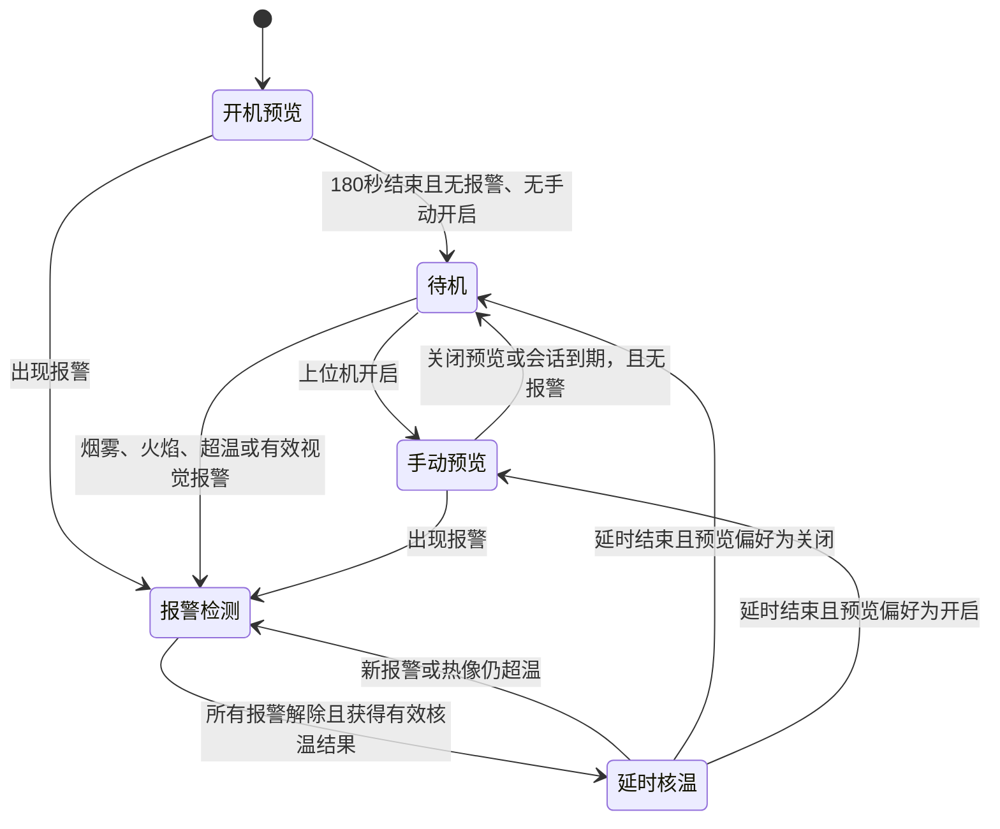

# 启动、传感器实时显示、热成像联动与巡检调速升级方案

日期：2026-10-08。状态：**待用户批准后实施**。

本轮已完成源码审查和修改前版本保存；本文中的修复、协议扩展、参数及验收指标均为拟实施内容，尚未改动运行代码、替换程序或烧录固件。用户已确认：**手动关闭热成像预览后，报警仍优先自动开启热成像核温**。

## 1. 当前版本已保存

项目实际由三个工作目录组成，Windows 项目根目录自身不是 Git 仓库。已有仓库中 F4、LongLook 的镜像落后于 Windows 当前文件，龙芯工作区另有 8 个未提交文件，不能只给原 HEAD 打标签就宣称当前版本已保存。

| 组件 | 实际开发目录 | 保存位置 |
| --- | --- | --- |
| 龙芯 PatrolSystem | `\\wsl.localhost\Ubuntu\opPJ\PatrolSystem` | 仓库原有 `src`、`include`、`config`、`deploy` 等，并纳入原有未提交修改 |
| STM32F407 | `F:\projectForXN\NGFXM\F4_VGT6first` | `STM32F407/F4_VGT6first`，保存源文件、CubeMX/CMake 配置和驱动依赖 |
| LongLook | `F:\projectForXN\NGFXM\LongLook` | `LongLook`，保存当前源码、EXE 和运行库 |
| 视觉报警模型 | `F:\projectForXN\NGFXM\YOLO模型` | `YOLO模型`，保存当前权重、验证脚本与模型说明 |
| 现有 F4 烧录产物 | `F:\projectForXN\NGFXM\F4_VGT6first\build\Debug` | `snapshots/pre-optimization-20261008/artifacts` 中的 HEX/ELF |

- 仓库：[ML08081/Long](https://github.com/ML08081/Long)。
- 原活动分支：`feat/Qt`；原 HEAD：`7ff5b3751ebe47d5439723e2294f03638ea9dba3`。
- 备份分支：[backup/pre-optimization-20261008](https://github.com/ML08081/Long/tree/backup/pre-optimization-20261008)。
- 最终基线提交：`c4d297ff480fec191385d3a31714a2cc80bf38c5`。其父提交 `4da90e4` 保存三端当前文件，此提交补充视觉模型依赖。
- 核验：272 个实际输入文件逐文件 SHA-256 与 Git 内保存内容一致；清单见 `snapshots/pre-optimization-20261008/manifest.json` 与 `vision-assets.json`。
- 龙芯 `VERSION` 仍为 `1.24.0`；保留已有源文件与二进制，不重新构建基线产物。
- 通过独立临时 Git 索引生成备份提交，原活动分支、暂存区和原有 8 项工作区修改均保持原状。

这里保存的是实际开发文件和本地已有产物。开发板 `192.168.3.112` 在本轮 SSH 检查中不可达，因此尚不能证明板上二进制、运行配置和 F4 Flash 与本地基线一致。后续部署前要补充实机版本、配置和二进制校验值，并留存板端回退包。

## 2. 已确认的问题与证据

下列位置以基线仓库路径为准，便于后续直接对照实现。

| 编号 | 证据位置 | 已确认的问题 | 影响与修复方向 |
| --- | --- | --- | --- |
| B01 | `deploy/systemd/patrol.service:6`、`deploy/scripts/setup_network.sh:29` | 主服务依赖网络初始化完成；脚本最多等待网卡 40 秒，随后还有两轮、多驱动、每驱动最长 12 秒的关联等待 | WiFi 异常会把本地传感器、屏幕和服务初始化一起延后；将本地启动与网络就绪解耦 |
| B02 | `deploy/systemd/patrol-usb-can2.conf`、`deploy/scripts/loong-usb-can-up.sh` | 应用排序在 CAN 初始化之后，USB-CAN 缺失时初始化有约 10 秒等待 | 在保留 PCAN 身份识别、can2 固定命名及后台恢复机制的前提下，移除应用对缺失设备的串行等待 |
| B03 | `deploy/scripts/start.sh`、`src/app/Application.cpp:177` | 包装脚本等待摄像头最多 3 秒，应用随后再最多重试 3 次；控制线程和 accept 循环在重试之后才启动 | 即使已先 listen，传感器和客户端实际服务仍延迟；摄像头在独立任务重试 |
| B04 | `src/business/RobotController.cpp:46`、`src/app/Application.cpp:190` | CAN/控制串口打开失败会提前返回，热成像串口和解算线程尚未初始化；控制线程只在初始链路打开成功时创建 | 开机 CAN 不可用可连带造成热成像不可用；各模块独立初始化，控制任务始终运行并重试连接 |
| B05 | `src/business/RobotController.cpp:353` | 主链路看门狗要求“端口已打开且曾收到遥测”，首次没连上不满足恢复条件；热成像专线缺少独立重开机制 | F4/设备晚就绪或专线断流后可能无法恢复；补充首次连接和热成像专线恢复 |
| B06 | `STM32F407/F4_VGT6first/Core/Src/freertos.c:1456` | 热成像循环持续采集/转发，仅有历史 PID 测试暂停分支；没有 180 秒启动预览或按报警启停状态机 | 当前代码未落实本次要求的功耗控制；在 F4 实现统一启停策略 |
| B07 | `LongLook/protocol.h:48`、`src/business/RobotController.cpp:419` | 当前网络命令只有风扇、蜂鸣器、继电器、LED、模式和急停，没有热成像控制命令和实际状态回读 | 需要新增上位机控制入口，并由 F4 实际执行结果回显 |
| B08 | `src/business/RobotController.cpp:604` | 环境数据转发只检查 `env_.valid`，没有使用已有 `lastEnvMs_`；风险计算也使用历史环境状态 | 即使环境帧停止，5Hz 综合遥测仍可能反复携带旧温湿度/有效位；按来源分别判定新鲜度 |
| B09 | `LongLook/mainwindow.cpp:768` | 链路健康依据收到综合帧的本机时刻判断，而综合帧可由龙芯定时重复产生 | “网络正常”不能证明 F4 或 DHT11 实际刷新；增加源样本序号/年龄和独立健康状态 |
| B10 | `STM32F407/F4_VGT6first/Core/Patrol/patrol.c:13`、`Core/Src/freertos.c:874` | F4 巡检基速固定为 300，路口速度固定 220，最低速度固定 140；巡检结果会覆盖远端速度命令 | 仅改上位机或龙芯数值不能实现巡检调速；必须增加 F4 运行时巡检速度参数 |
| B11 | `LongLook/remotepanel.cpp:163`、`:190`、`remotepanel.h:38` | 手动滑条连续变化，方向按钮固定 400/300，手柄档位为 300/600/1000 | 速度入口不统一；新增 100～1000、步长 50 的速度配置并统一按钮/手柄限速 |

**源码中的当前巡检基速是 300，不能把用户感觉“速度快”直接解释成巡检正在以 1000 运行。** 新默认 500 按用户要求设置；转弯改善还依赖转弯限速、减速过程和实车整定，不能只提高/降低一个常量。

已存在的保护应保留：DHT11 约 2.1 秒单次采样、约 7 秒无成功样本失效；热成像 EEPROM 候选区验证与有效副本保留；龙芯/LongLook 约 3 秒无新热像时清除历史画面/热点。

本轮尚未实测确认：这次 DHT11 读失败的具体错误码，热成像是无字节/组帧失败/无 EEPROM/解算失败中的哪一级，实机供电和摄像头枚举状态，以及启动慢分别有多少来自引导、内核和应用层。上述代码缺陷成立，但不能代替本次硬件故障的现场诊断。

## 3. 升级后的行为

### 3.1 开机 180 秒内

以 **F4 本次上电启动的单调时钟**为计时依据，热成像在默认自动模式下开启 180 秒；温湿度、烟雾/气体、火焰、超声波、激光和运动遥测各按其采样能力持续更新。

- 热成像按当前 2Hz 子页刷新配置工作；两种子页组成一幅完整温度场，不能把 2Hz 子页刷新宣称为全图每秒全部更新两次。
- 温湿度维持约 2.1 秒取得一个新样本，成功即更新；上位机 5Hz 重绘/收帧不代表 DHT11 5Hz 测量。数值不变也可以是有效新样本。
- 上位机显示“开机预览，剩余 xx 秒”、热像实际状态，以及传感器最后成功更新时间。
- 上位机重连、龙芯应用重启和 CAN 恢复不重置 F4 的 180 秒计时；F4 真正复位才重新开始。
- F4 初始化热像失败时保留预览请求，后台有限时、退避恢复，其他传感器和通信继续运行；不显示伪造温度图。

### 3.2 180 秒后

温湿度与其他用于检测报警、运动控制的传感器继续刷新。正常状态下只让热成像进入停止采集/传输/解算的状态，避免关闭报警来源后再也无法触发唤醒。

任一新鲜有效来源满足下列条件时开启热成像：MQ2 烟雾/气体报警、物理火焰传感器报警、DHT11 环境超温、视觉火焰、视觉烟雾。视觉处理当前运行在 LongLook，依赖摄像头、模型和上位机推理进程正常；本轮不迁移 YOLO 到龙芯。

热像已开启后，龙芯识别出的有效高温热点也可延长检测，直到有新鲜降温样本且满足解除条件。**关闭中的热像不能发现新的热点**，此时靠始终运行的环境/烟雾/火焰/视觉来源唤醒。

### 3.3 上位机控制

| 选择 | 无报警时 | 有报警时 |
| --- | --- | --- |
| 自动 | 180 秒启动预览后停止热成像 | 自动开启核温 |
| 手动开启 | 持续实时预览 | 保持开启并显示报警来源 |
| 手动关闭预览 | 结束当前手动/启动预览，进入待机 | **报警覆盖关闭请求，自动开启核温** |

“手动关闭预览”记录的是用户的预览偏好；报警解除并完成延时后恢复该偏好。上位机显示请求状态与实际状态，例如“已关闭预览；烟雾报警正在开启核温”，避免开关位置和实际运行含义不清。

手动常开限于当前连接会话，上位机断开约 5 秒后回到自动策略，避免断网后一直保持手动高开销；物理报警和仍然有效的远程报警不受此回退影响。该会话规则是本方案的拟实施默认值。

### 3.4 拟采用的可配置参数

| 参数 | 建议初值 | 说明 |
| --- | --- | --- |
| 启动预览 | 180 秒 | 用户明确要求 |
| 环境超温开启 / 解除 | 45°C / 42°C | 新增建议参数，结合使用场景实车校准 |
| 热像热点开启 / 解除 | 50°C / 45°C | 开启值沿用龙芯当前 50°C，增加解除回差 |
| 报警解除后继续核温 | 30 秒 | 所有唤醒来源解除后计时；新报警刷新计时 |
| 视觉结果有效期 | 3 秒 | 延续当前新鲜度；过期不能永久锁住热像 |
| 手动预览断连回退 | 5 秒 | 回自动，保留本地报警联动 |
| 环境帧失效 | 2 秒 | 来源链路不更新则撤销温湿度/激光等有效显示 |
| DHT11 样本失效 | 7 秒 | 延续当前 F4 保护；UI 同步显示样本年龄 |
| 运行热像失效 | 3 秒 | 仅在应当开启且超过启动宽限时判故障 |

温度阈值是软件初始配置建议，并非器件精度或经现场验证的消防判据。环境超温用有效 DHT11 样本判断；传感器失效显示故障，不把 0°C 或旧样本当成正常。

## 4. 三端职责与热成像状态机

**F4 持有最终启停状态**，负责 180 秒计时、本地传感器报警、热像采集与串口发送。龙芯负责配置转发、视觉结果与热像温度融合、解算、链路恢复和状态汇总；LongLook 负责操作和实际状态显示。

设备执行状态另行记录 `OFF / STARTING / STREAMING / FAULT`，与“为什么要开启”分开。初始化或运行失败转 FAULT 并后台重试，需求仍保留；预览/报警需求解除后可回 OFF。温湿度或热像失效时，不能宣称已获得正常核温结果。

实现约束：

1. 任何报警可覆盖手动关闭；本地烟雾、火焰、超温无需等待龙芯决定。
2. 唤醒时清空旧原始帧、半幅缓存、发送队列中的旧热像和旧热点；标定未失效则保留有效校准。
3. 开启时立即发送必要的有效 EEPROM，接收侧主动请求缺失标定；不依赖下一次 10 秒周期重发。首次图像需两种新子页到齐。
4. 只有应开启且已过启动宽限仍无新块/新图时才运行断流恢复；主动关闭不触发故障重开或循环初始化。
5. 串口关闭/重开仍由负责读取的线程串行执行，避免解算线程读到已关闭 fd。
6. 用位图记录烟雾、物理火焰、环境超温、视觉火焰/烟雾、热点、手动和启动预览等来源；不得用包含障碍等级的综合 risk 直接决定热像开启。
7. 180 秒预览是一次性窗口，结束后保持结束状态；HAL tick 回绕不应重新进入预览。

## 5. 功耗目标与边界

关闭预览时应实际停止 F4 原始帧读取/大帧发送，并让龙芯解算线程等待事件、停止热图上报，不能只让上位机隐藏图片。

当前软件没有发现热像模块独立电源使能控制。MLX90640 手册将正常测量描述为持续运行，也没有给出可以据以承诺微安级待机的 sleep 电流规格。因此，**停止软件读取不等于切断传感器电源**；本版先验收采集、传输、解算开销下降，并实测模块/整机电流。参考：[Melexis MLX90640 数据手册，§8、§10.3～10.4](https://www.melexis.com/-/media/files/documents/datasheets/mlx90640-datasheet-melexis.pdf)。

若用户的功耗目标要求热像模块真正断电，需要先核实现有接线是否具备独立可控电源，再单独设计硬件改造及上电恢复；本次软件升级不擅自改引脚或承诺模块零功耗。寄存器 data-hold 仅可作为测量验证项，不能当作已证实的深度休眠实现。

## 6. 启动加速与实时显示修复

1. 本地业务、屏幕和设备连接管理不等待 WiFi 关联完成；监听 `0.0.0.0` 后，地址出现即可对外服务。网络脚本继续后台恢复，避免因依赖取消而丢失 WiFi 自连能力。
2. CAN 仍使用已验证的 `can2`/PCAN 身份识别和恢复机制，禁止按接口编号操作板载 CAN；处理与屏幕 GPIO72/73 的既有约束。本轮不改内核、设备树或屏幕引脚。
3. 初始 CAN 缺失不阻止热像串口、屏幕或网络启动；控制线程仍周期执行，缺少设备时退避重试；恢复后重新同步有效配置，不自行启动运动。
4. 摄像头由独立恢复任务管理，缺失/晚枚举/运行中掉线都不阻塞其他业务。连续取帧失败后后台恢复，而非退出后等待用户重连。
5. 记录进程入口、TCP 监听、F4 首帧、DHT11 首个成功样本、标定就绪、首幅完整热像和首帧视频的单调时间差。
6. 综合遥测保留来源状态：F4 核心遥测、环境帧、DHT11 成功样本、热像分别记录年龄/序号。综合帧重复发送不刷新源样本时钟。
7. 环境帧超过 2 秒未更新时撤销对应有效显示；新鲜故障信息与历史报警记录分开，不把失联等同于报警已解除或已证实安全。
8. LongLook 显示“网络连接正常”“F4 数据失效”“DHT11 读取失败”“热像待机/启动中/断流”等具体状态；记录失败码和组帧/标定/解算计数以定位真实故障。

启动优化先以日志分段验证。整机上电到内核可运行之前的引导耗时，不属于移除应用等待就必然改善的部分。实机不具备 `systemd-analyze` 时，使用 `/proc/uptime`、服务单调时间戳和 journal 时间差采样。

## 7. 速度控制设计

### 7.1 配置与实际运动分开

- 可配置巡航档位：`100, 150, 200, …, 950, 1000`，共 19 档；自动巡检默认 **500**。
- 手动控制新增速度上限/档位选择，默认建议 500；方向按钮与手柄遵守所选上限。方向和停车保留正负号/0 的现有含义。
- 这些数值沿用当前控制命令的归一化尺度，不能标为 RPM 或 cm/s；编码器实测速度另行显示。
- 100 是巡航配置下限。转弯、避障、停车、PID 和加减速过程可以产生更低输出，停车始终为 0；不把实际输出强制量化到 50。
- 配置输入在三端校验范围和步长，非法值拒绝并回报。F4 未确认前 UI 显示“待应用”，不得仅在界面改数字就显示成功。

### 7.2 必须进入 F4 本地巡检控制

为 `Patrol` 增加运行时巡航速度及 get/set 接口，代替 `PATROL_SPEED` 固定值；由 MotionControlTask 消费配置快照，CAN 中断只收包/置标记。

普通弯道和路口增加独立速度上限，建议先以现有路口速度 220 为保守上限；实际值始终不超过当前所选巡航档位。既有固定最低值 140 改为受所选档位限制，且不能覆盖避障减速/停车。

例如选择 100 时，直行不超过 100，转弯和找线也不超过 100，不能被固定 140/220 抬高；选择默认 500 时，直行可到 500，明显转向/路口控制在不超过 220，并按距离进一步减速。

拟增加正常加速限幅：约每 100ms 最多增加 50 控制单位，下降优先及时执行；急停、丢线、近障停车直接归零。改变巡检配置不能解除急停、改变运行模式或重新启动已停止巡检。最终轮端行为仍需架空检查和低速实车验证。

### 7.3 保存与恢复

自动巡检速度保存在龙芯配置，缺少配置时为 500；已有显式合法配置应保留。F4 冷启动默认 500，收到确认后的配置才更新；进入巡检前核对设备实际值，未同步时保持停止，防止以旧档位起步。

龙芯重启/链路重连后同步已保存值；上位机显示 F4 实际应用速度。保存配置采用完整校验和原子写入，避免中途断电留下半个配置文件；本轮不引入 F4 Flash 频繁写入。

## 8. 协议与修改范围

保持当前 CAN 控制和热像串口的分工，热像大数据不迁入 CAN。

| 链路 | 拟增加内容 | 兼容约束 |
| --- | --- | --- |
| TCP 命令 `0x40` | 新命令 `0x07` 热像预览模式；`0x08` 巡检速度档位 | 现有 value 为 u8，速度用档位 0～18 编码，`speed=100+50*gear`；禁止直接把 500 写入 u8 |
| CAN `0x301` | 新 sub `0x05` 热像请求/有效远程来源；`0x06` 巡检速度配置，携带请求序号 | 已废弃 PID sub `0x04` 保留，不复用；CAN 中断不执行 I2C 或文件写入 |
| CAN `0x481` | 新状态/样本新鲜度子帧，包含实际热像状态、唤醒来源、剩余预览时间、实际速度档位和配置确认序号 | 原有 sub `0x03` PID 遥测保留；按 8 字节限制拆分状态，不挤占原环境字段 |
| TCP 上报 | 新设备状态帧（拟用 `0x02`），含协议能力、实际状态、来源年龄和确认结果 | 保留现有 42 字节传感器前缀；旧上位机忽略未知类型，新上位机连接旧端显示“不支持” |
| UART 手动备用模式 | 对应配置与状态扩展 | 保留原控制帧与 PID 废弃编号；明确识别是否支持，不自动从 CAN 切 UART |

实施前再次核对全仓库类型号无冲突，并冻结字节序、长度与状态枚举。配置确认必须来自 F4 应用结果，发送成功只代表进入链路，不能等同于设备执行成功。发送失败保留待发配置并有限重试；重复命令幂等，重试不能重复开始巡检或重置 180 秒窗口。

主要修改位置：F4 的 `freertos.c`、`Patrol`、`CAN`、`Protocol`、热像高层；龙芯 `Application`、`RobotController`、传输层、配置和部署服务；LongLook `mainwindow`、`remotepanel`、`netclient`、协议定义。DHT11 驱动只在现场失败码证实需要修复时改动，不为了刷新界面提高读取频率。

## 9. 实施顺序与验收

批准后建议以 `feat/sensor-thermal-speed-20261008` 开发分支承接上述基线，分项提交。龙芯版本拟升至 `1.25.0`，三端打包记录各自提交和文件校验值。

1. **启动与连接修复**：独立初始化、移除网络/摄像头串行等待、首次无设备恢复、来源新鲜度。先验证无设备时仍能正常启动。
2. **热像联动**：F4 状态机、跨端控制/实际状态、EEPROM 唤醒同步和正确的断流恢复。
3. **调速**：F4 运行参数、限转弯速度、上位机档位与实际确认、配置保存。
4. **构建与联调**：龙芯本地/LoongArch 构建、F4 ELF/HEX 同步生成、LongLook 构建；再做协议仿真、架空检查、实机传感和低速巡检。

| 验收项 | 条件与预期 |
| --- | --- |
| 启动分段 | 记录实际三次冷启动各阶段耗时；目标是应用入口后约 1 秒内监听，CAN 正常时无摄像头仍在约 2 秒内可获取综合数据；不把该目标宣称为整机冷启动时间 |
| 网络失败 | WiFi 缺失时 F4、热像、屏幕照常运行；网络恢复后可重新连接并取得源数据 |
| CAN 初始缺失 | 应用与热像串口仍启动；适配器/F4 恢复后重新获取遥测与配置，机器人不因重连自行运动 |
| 启动窗口 | 第 0～180 秒按默认策略持续采集；无报警时 180 秒后热像停止，温湿度/烟雾/测距继续更新 |
| 唤醒来源 | MQ2、物理火焰、环境超温、视觉火焰、视觉烟雾分别能独立唤醒，普通障碍不会误开热像 |
| 手动关闭与报警 | 关闭预览后报警仍开启；报警解除并完成 30 秒核温后恢复用户关闭偏好 |
| 唤醒延迟 | 正常硬件下目标为报警/手动请求后约 3 秒内出现首幅新鲜完整热像；记录 EEPROM 和子页耗时，异常时明确显示故障 |
| 热像完整性 | 2Hz 子页配置下，两种子页都持续更新，全图约每秒完成一次更新；不把上一轮半幅图混入唤醒后的首图 |
| 温湿度真实性 | 成功样本序号按约 2.1 秒增长；温湿度数值不变不报冻结；读失败/样本过期和环境帧断流可分别识别 |
| 运行时关闭 | 热像 raw/EEPROM 发送与解算计数停止增长；没有超时重开风暴；记录关闭前后的 CPU、串口流量和电流 |
| 摄像头掉线 | 已连接会话内自动退避恢复视频，传感器、热像和命令通路不中断 |
| 档位边界 | 验证 100、150、500、950、1000 均应用到 F4；99、125、1050 等非法输入拒绝；上/下界不能越界 |
| 低速转弯 | 选择 100 时直行、路口、找线均不超过该值；最低速度逻辑不反向提速；默认 500 时转弯限速实际生效 |
| 运动保护 | 急停/丢线/近障立即停车，调速和重连不解除急停；正反切换先归零；坡道/负载下低档是否能驱动另做实车记录 |
| 重启与回绕 | PC 重连/龙芯重启不重置预览；F4 复位重启预览；时钟回绕不重启预览或永久锁定报警 |
| 稳定性 | 全链路至少 30 分钟运行并记录断流恢复、CAN 错误、I2C 失败、复位原因，不能仅凭 service active 验收 |

对状态转换、数据新鲜度、非法档位、低档不被最低/转弯常量抬高、配置重试和版本兼容编写有针对性的离线测试；普通显示布局和可逆文案不单独堆叠实现镜像测试。

## 10. 回退与审批

修改前基线分支保留不混入升级提交。实现前、部署前分别记录 Git 提交；部署前另备份开发板 `/usr/bin/patrol_system`、`/etc/patrol/config.json`、有关 systemd 单元/脚本，并确认实际 F4 烧录版本。保留现有屏幕与 USB-CAN 恢复配置。

恢复源码时先把基线导出到新目录核对，不对有未提交修改的当前目录执行强制 reset。恢复程序/固件时使用对应校验值的旧 EXE、HEX 和板端备份，不把本地历史构建产物自动当成板上原版本。

**本次请求审批的实施内容**：B01～B11 的启动/连接/实时性修复；180 秒预览、报警优先的热像启停与真实状态回读；100～1000、步长 50、默认 500 的巡检速度配置及转弯限速；上述协议、软件配置、验证与发版工作。环境 45/42°C、热像 50/45°C、解除延时 30 秒和手动会话 5 秒回退为拟采用初值，可在批准时调整。

审批前仅保存现有版本和方案；不实施功能修复、不替换 EXE、不烧录 F4、不部署龙芯，也不发运动命令。此阶段边界直接来自用户“经过我的批准后再进行修改和升级”的要求。
